<p align="center">
  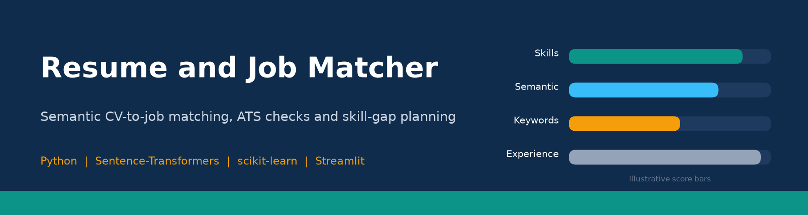
</p>

<p align="center">
  
  
  
  
  <a href="LICENSE"></a>
</p>

<p align="center"><b>Live demo:</b> <a href="https://resume-job-matcher-24ddesoq2txwkbmpsrdtur.streamlit.app">resume-job-matcher.streamlit.app</a></p>

<table align="center">
  <tr>
    <td align="center"><h2>0.98</h2>pairwise ranking accuracy<br>on 32 labelled CV/job pairs</td>
    <td align="center"><h2>4 of 4</h2>sample jobs where the best-fit<br>CV was ranked first</td>
    <td align="center"><h2>0 API keys</h2>runs entirely on free,<br>open-source models</td>
  </tr>
</table>

---

An end-to-end AI screening tool that scores a CV against a job description, explains the score component
by component, and turns the gaps into **concrete, prioritised improvements**: missing skills with a learning
plan, missing keywords with where to add them, ATS formatting issues and rewritten bullet points. A recruiter
mode ranks a whole candidate pool and exports a shortlist. Built by **Kinza Amjad**.

<p align="center">
  
</p>

## Why it matters
Most applications are filtered by software before a person reads them, and candidates rarely learn why
they were rejected. Recruiters face the opposite problem: hundreds of CVs and little time to read them
consistently. This project gives both sides a transparent, explainable score, combining modern semantic
language models with an auditable skills taxonomy, so every number can be traced back to the text that produced it.

> **Honest note:** all sample CVs and job descriptions in `data/` are **synthetic and fictional**, written
> for demonstration. The evaluation set is small (32 pairs), so its figures are a sanity check rather than a
> benchmark. The tool supports screening decisions; it should not replace human review.

## Features
- **Overall match score** from five transparent, weighted components: skills, semantic similarity, keywords, experience and education
- **Semantic matching** with `all-MiniLM-L6-v2` sentence embeddings, comparing each job requirement with the closest CV line, plus an automatic TF-IDF fallback if the model is unavailable
- **Skill extraction** from a curated taxonomy of 98 skills in 7 categories, separating required from preferred skills
- **Keyword optimisation**: the job's key phrases highlighted in the CV, with missing terms and the section where each should go
- **ATS compatibility check** with an ATS-readiness score: standard headings, contact details, length, tables and columns, embedded images, scanned PDFs, decorative symbols
- **Bullet-point improver**: detects bullets without an action verb or a measurable result and proposes rewrites with strong verbs and quantification templates
- **Experience-level fit**: estimated years of experience (explicit statements or merged date ranges) against the job's requirement, with seniority matching
- **Skill-gap learning plan**: a short, curated study note for every missing skill (offline, no web calls)
- **Downloadable PDF report** of the full analysis
- **Compare jobs**: one CV against up to three job descriptions, with a radar chart showing which role fits best
- **Recruiter mode**: rank many CVs against one job, filter by must-have skills and minimum score, export the shortlist to CSV
- **PDF, DOCX and TXT** uploads, or pasted text; files are processed in memory and never stored

## Screenshots
<table>
  <tr>
    <td>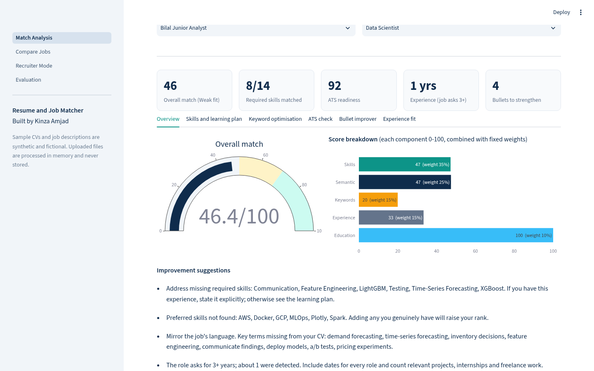<p align="center">Match overview and score breakdown</p></td>
    <td>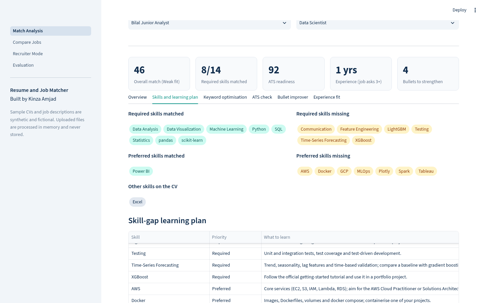<p align="center">Skills and learning plan</p></td>
  </tr>
  <tr>
    <td>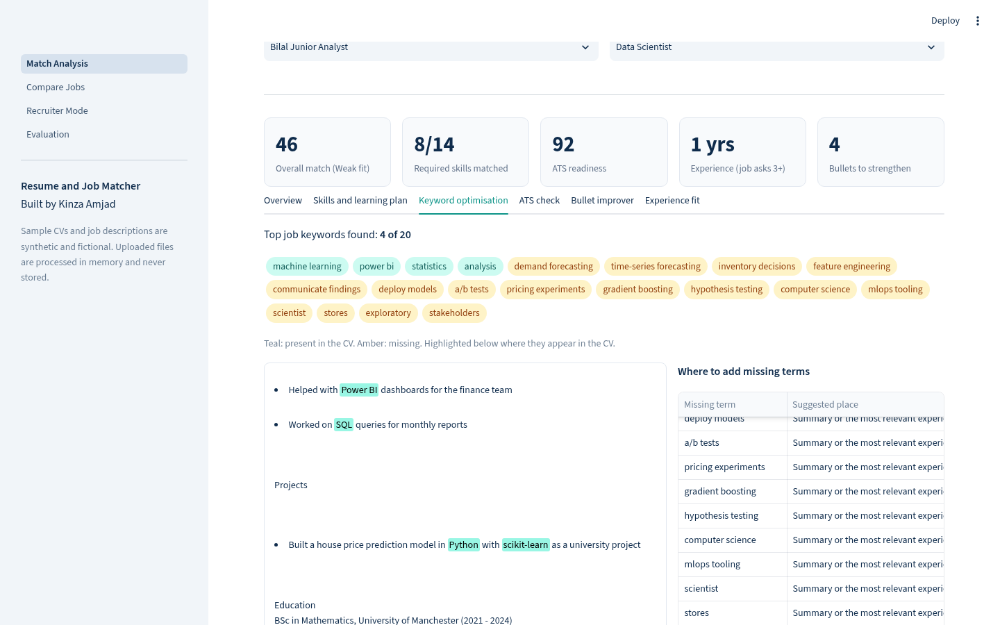<p align="center">Keyword optimisation</p></td>
    <td>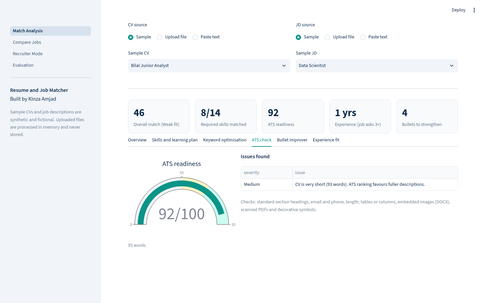<p align="center">ATS compatibility check</p></td>
  </tr>
  <tr>
    <td>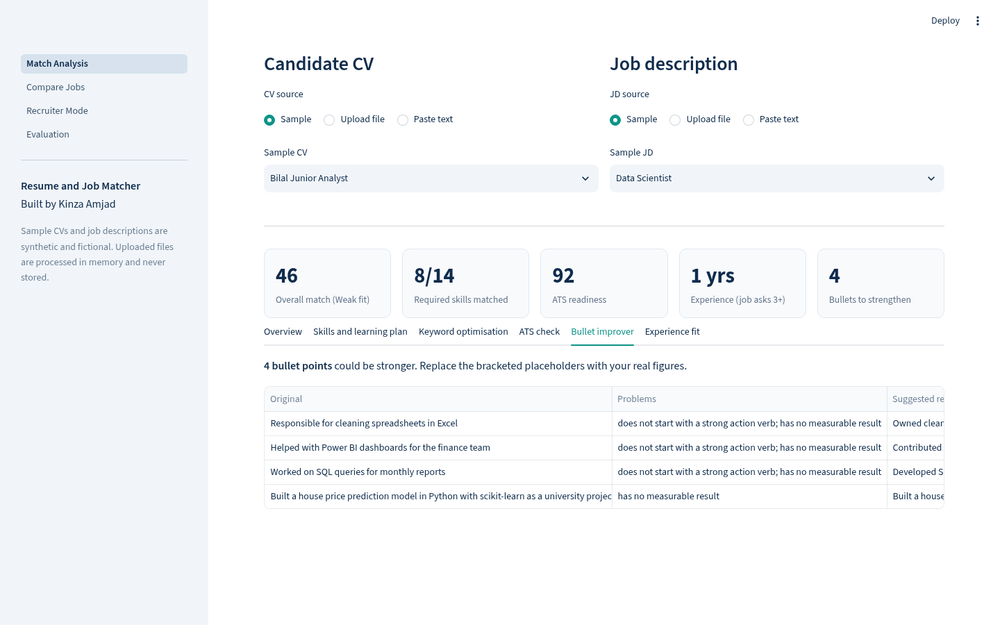<p align="center">Bullet-point improver</p></td>
    <td>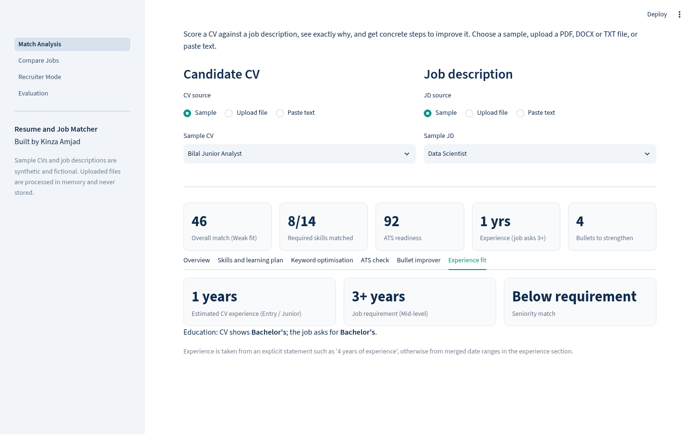<p align="center">Experience-level fit</p></td>
  </tr>
  <tr>
    <td>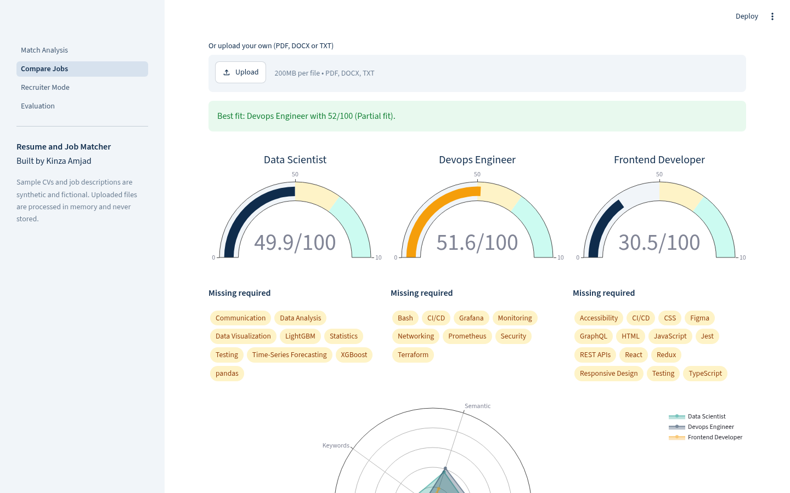<p align="center">Compare up to three jobs</p></td>
    <td>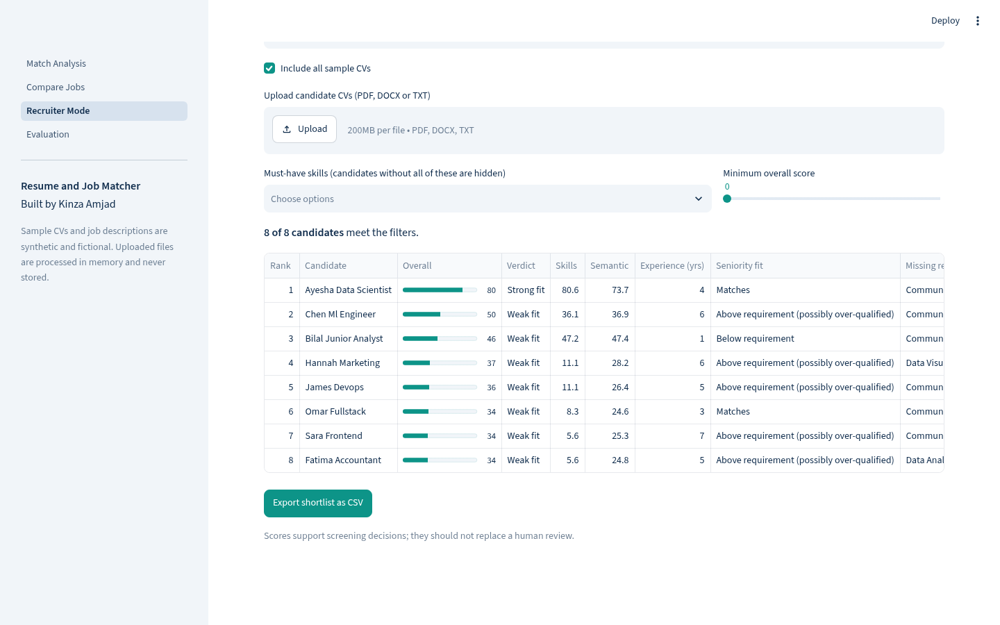<p align="center">Recruiter mode and shortlist export</p></td>
  </tr>
</table>

## How it works
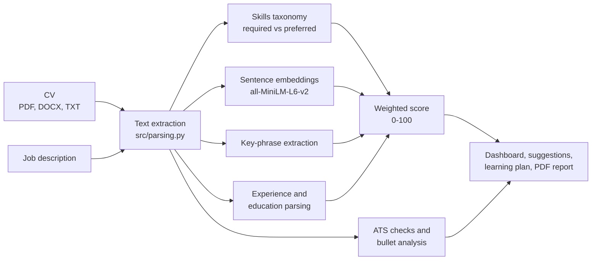

| Component | Weight | How it is measured |
|---|---|---|
| Skills | 35% | Share of the job's required skills found in the CV (preferred skills count half) |
| Semantic | 25% | Mean, over job requirement lines, of the best cosine similarity to any CV line |
| Keywords | 15% | Coverage of the job's top 20 key phrases |
| Experience | 15% | Estimated CV years divided by the job's minimum years (capped at 100) |
| Education | 10% | Full marks if the CV meets the degree level the job asks for |

## Results
All numbers come from an actual run of `python tools/evaluate.py` on Python 3.12 with the pinned `requirements.txt`.
**Test set:** 8 synthetic CVs x 4 synthetic job descriptions = 32 pairs, each hand-labelled good, partial or poor fit
before the scorer was run (`data/labels.csv`). Pairwise accuracy counts, within each job, how often a better-labelled
CV scores higher than a worse-labelled one (60 comparable pairs).

<p align="center">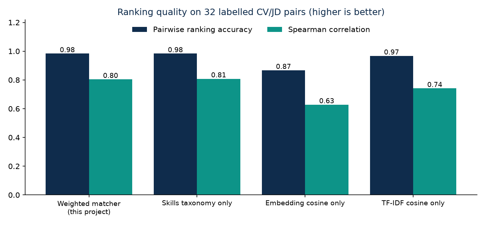</p>

| Method | Spearman | Pairwise accuracy | Best CV ranked first | Good-vs-rest AUC |
|---|---|---|---|---|
| **Weighted matcher (this project)** | **0.804** | **0.983** | **4/4** | **1.000** |
| Skills taxonomy only | 0.808 | 0.983 | 4/4 | 1.000 |
| TF-IDF cosine only | 0.741 | 0.967 | 4/4 | 1.000 |
| Embedding cosine only | 0.628 | 0.867 | 4/4 | 1.000 |

<p align="center">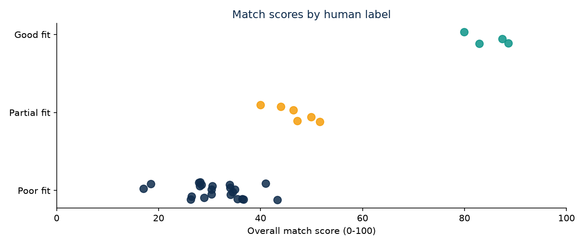</p>

Mean overall score: **good fit 84.7**, **partial fit 46.5**, **poor fit 31.2**.

<details>
<summary><b>Reading these results honestly</b></summary>

- The weighted matcher ranks 59 of 60 comparable pairs correctly. The single mistake is on the marketing role,
  where a data scientist (labelled poor, 41.0) scored slightly above an accountant (labelled partial, 40.0).
- On this small set, the skills component alone ranks as well as the full weighted score. The value of the
  combined score is robustness and explanation: semantic similarity still credits experience phrased without
  taxonomy terms, and the experience and education components flag seniority gaps a skills list cannot.
- Raw embedding similarity is the weakest single signal, which is why it is used per requirement line and
  combined with the other components rather than on its own.
- Per-pair scores are saved in `docs/eval_scores.csv`. A larger, real-world labelled set is the next step.
- Scoring all eight sample CVs against one job takes about 0.07 s per CV on a laptop CPU after the model has loaded.
</details>

## Getting started

```bash
cd resume-job-matcher
python3.12 -m venv .venv && source .venv/bin/activate
pip install -r requirements.txt
streamlit run app.py          # opens http://localhost:8501
```
The first run downloads the open-source `all-MiniLM-L6-v2` model (about 90 MB). No API keys are required.

<details>
<summary><b>Test, evaluate and rebuild the assets</b></summary>

```bash
pip install -r requirements-dev.txt
pytest -q                          # unit tests and headless tests of every page
python tools/evaluate.py           # re-run the evaluation and charts
python tools/make_banner.py        # rebuild docs/banner.png
python tools/capture.py            # screenshots and demo GIF (app must be running on port 8611)
```
On Windows, activate the environment with `.venv\Scripts\activate`.
</details>

<details>
<summary><b>Deploy on Streamlit Community Cloud</b></summary>

1. Push this repository to GitHub (public).
2. Go to [share.streamlit.io](https://share.streamlit.io), click **New app**, pick the repository, branch `main`, main file `app.py`.
3. Under *Advanced settings* choose Python **3.12**. `requirements.txt` installs the CPU-only build of PyTorch to keep the app small.
</details>

<details>
<summary><b>Project structure</b></summary>

```
resume-job-matcher/
├── app.py                         # entry point and navigation
├── pages/
│   ├── 0_Match_Analysis.py        # single CV analysis, all six tabs, PDF report
│   ├── 1_Compare_Jobs.py          # one CV against up to three jobs
│   ├── 2_Recruiter_Mode.py        # rank, filter and export candidates
│   └── 3_Evaluation.py            # evaluation results
├── src/
│   ├── parsing.py                 # PDF, DOCX and TXT text extraction
│   ├── skills.py                  # curated skills taxonomy and extraction
│   ├── profile.py                 # experience, education and seniority
│   ├── matcher.py                 # weighted scoring, key phrases, suggestions
│   ├── ats.py                     # ATS checks and bullet-point improver
│   ├── learning.py                # offline learning notes for skill gaps
│   ├── report.py                  # PDF report (reportlab)
│   ├── data.py                    # sample data access
│   └── ui.py                      # shared Streamlit components and theme
├── data/
│   ├── sample_cvs/                # 8 synthetic CVs
│   ├── sample_jds/                # 4 synthetic job descriptions
│   └── labels.csv                 # hand labels for evaluation
├── docs/                          # banner, GIF, screenshots, charts, eval results
├── tests/                         # pytest unit and app tests
└── tools/                         # evaluation, banner and capture scripts
```
</details>

## Privacy
Uploaded files are read in memory for the current session only. Nothing is stored, logged or sent to a third-party service.

## License
[MIT](LICENSE) © 2026 Kinza Amjad
